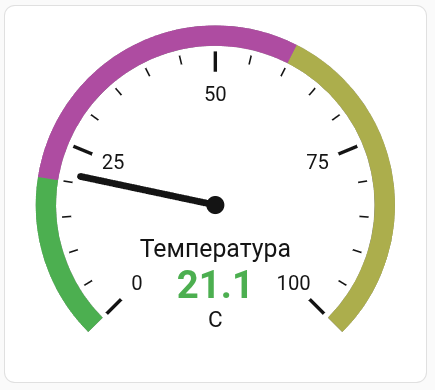
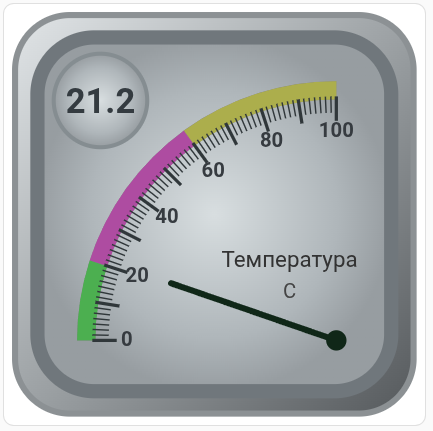
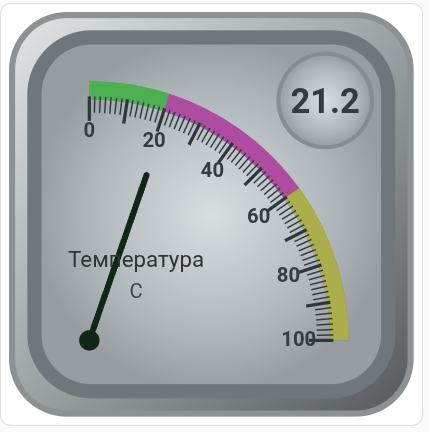
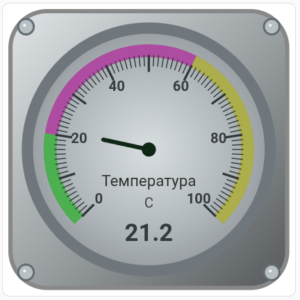
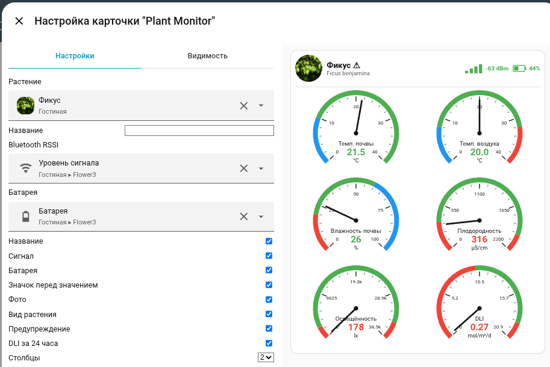

<p align="center"></p>

<h1 align="center">HA Template Card</h1>
<p align="center">Standalone dashboard cards for Home Assistant with built-in visual editors.</p>

[](https://hacs.xyz/) [](https://github.com/immortalserg/ha_template_card/releases)

Three independent Lovelace cards in one JavaScript module. No Button Card, Mushroom, Node-RED or other custom-card dependencies.

## Gauge styles

| Classic | Metallic corner (left) |
| :---: | :---: |
|  |  |
| **Metallic corner (right)** | **Metallic circular** |
|  |  |

## Installation

### HACS
Add `https://github.com/immortalserg/ha_template_card` as a **Dashboard** custom repository in HACS. Download the latest release and refresh Home Assistant. Future updates are available through HACS.

### Manual
Copy `ha-template-card.js` to `/config/www/ha_template_card/ha-template-card.js` and register it as a JavaScript module in **Settings → Dashboards → Resources**:

```text
/local/ha_template_card/ha-template-card.js
```

## Plant Monitor Card



- Seven individually selectable gauges: soil and air temperature, soil moisture, air humidity, conductivity, illuminance and DLI.
- Automatic discovery of Plant Monitor sensors and thresholds, with manual overrides.
- One, two or three columns; full-width gauges in single-column mode.
- Four gauge styles, configurable globally or individually.
- Adjustable fonts, text offsets, needle length and thickness, and corner value bubble position.
- Optional plant picture, species, problem indicator, Bluetooth signal and battery.

```yaml
type: custom:plant-monitor-card
entity: plant.fikus
signal_entity: sensor.3_signal
battery_entity: sensor.flower3_battery
gauge_columns: 2
gauge_style: classic
```

## HA Template Gauge Card

A standalone gauge for any compatible numeric sensor. Configure the scale minimum and maximum, up to five optional color intervals, precision, label, units, style and appearance in the visual editor. Unconfigured intervals are omitted.

```yaml
type: custom:ha-template-gauge-card
entity: sensor.co2_co2
name: CO₂
unit: ppm
scale_min: 0
scale_max: 3000
decimals: 0
gauge_style: vintage_circle
zone_1_from: 0
zone_1_to: 1000
zone_1_color: '#4caf50'
zone_2_from: 1000
zone_2_to: 1500
zone_2_color: '#ff9800'
zone_3_from: 1500
zone_3_to: 3000
zone_3_color: '#f44336'
gauge_needle_length: 100
```

## Flower BLE Card

Compact Bluetooth RSSI and battery indicators with a free-text name. Choose horizontal or vertical layout and the order of all three elements. No primary entity is required.

```yaml
type: custom:flower-ble-card
name: Ficus
signal_entity: sensor.3_signal
battery_entity: sensor.flower3_battery
ble_layout: horizontal
ble_order: name,battery,signal
```

## Notes

This is a frontend dashboard extension, not a backend Home Assistant integration. Plant Monitor Card uses entities from the separate Plant Monitor integration; the other two cards can be used independently.

Report issues and suggestions in [GitHub Issues](https://github.com/immortalserg/ha_template_card/issues).
